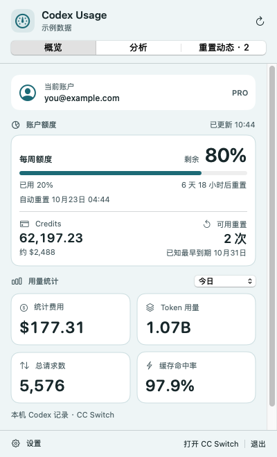
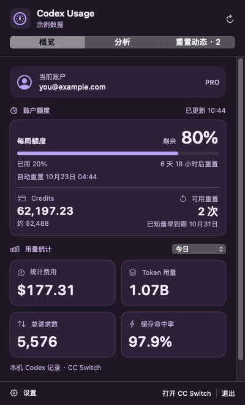
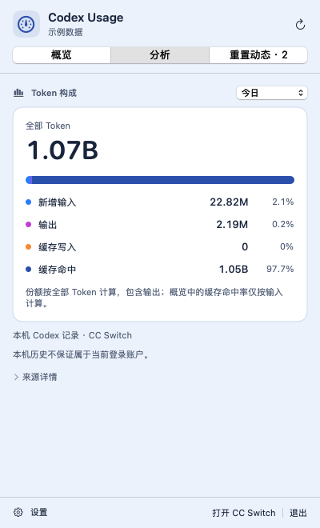
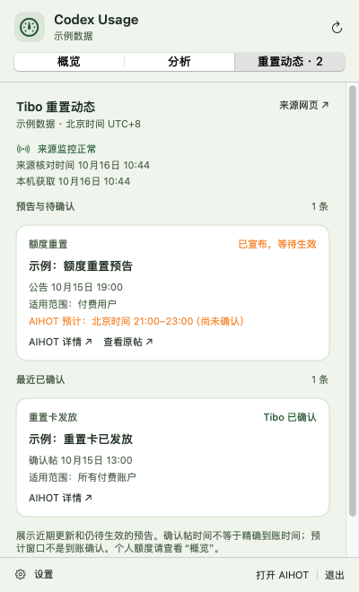
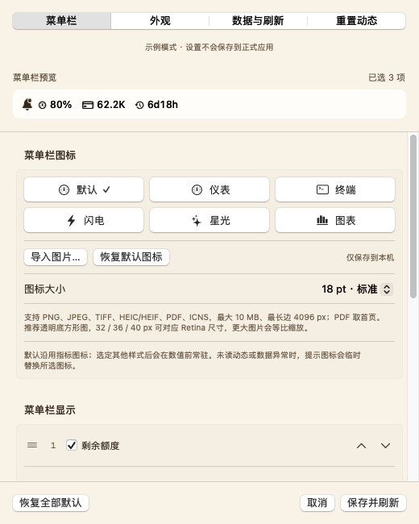
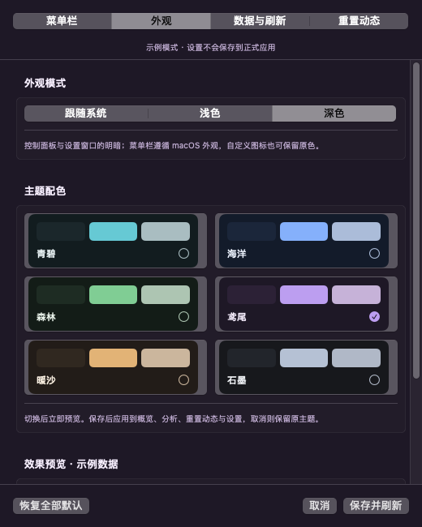

<p align="center">
  
</p>

<h1 align="center">Codex Usage</h1>

<p align="center">
  <a href="README.md" lang="zh-CN">简体中文</a> · <strong>English</strong>
</p>

<p align="center">Codex limits, usage, and reset news in your macOS menu bar.</p>

<p align="center">
  
</p>

<p align="center">
  <a href="https://github.com/brickmove/codex_usage/releases/latest">Download the latest release</a> ·
  <a href="#quick-start">Quick start</a> ·
  <a href="docs/user-guide.md">User guide (简体中文)</a> ·
  <a href="https://github.com/brickmove/codex_usage/issues">Report an issue</a>
</p>

> The main branch includes an unreleased icon-set fix. The latest download remains v0.5.0. Public releases are at least one calendar month apart; see the [changelog](CHANGELOG.md) and [release policy](docs/development.md#发布流程) (Simplified Chinese).

A native SwiftUI / AppKit menu bar app that uses your existing Codex sign-in and reads statistics already stored by CC Switch. Keep the metrics you choose in the menu bar, then open the panel for account details, limits, and usage.

<table>
  <tr><th>Light appearance</th><th>Dark appearance</th></tr>
  <tr>
    <td align="center"><a href="docs/images/screenshots/0.5.0/overview-light.png"></a></td>
    <td align="center"><a href="docs/images/screenshots/0.5.0/overview-dark.png"></a></td>
  </tr>
</table>

*Screenshots show the released native 0.5.0 interface; unreleased changes are listed in the changelog. The interface is in Simplified Chinese. All accounts, usage, and news shown are sample data, not real account data or official announcements. Click an image to view it at full size.*

## Features

| What you want to know | What Codex Usage shows |
| --- | --- |
| How much capacity is left | Weekly and other limit windows, Credits, automatic reset times, and available resets |
| What appears in the menu bar | Choose metrics, drag to reorder, or show only the icon; hover for full metric names and time ranges |
| How much you used in a time range | Stored cost, token usage, request count, and cache hit rate; defaults to today, with other ranges available |
| How to customize the look | Four icon sets with distinct symbols for each metric, optional per-metric images, and three sizes; six themes with independent System, Light, and Dark modes |
| Where tokens went | New input, output, cache writes, and cache hits, with counts and shares |
| Whether there is reset news | A dedicated news tab, source links, and an optional unread indicator in the menu bar |
| Whether the data is current | Distinct states for expired data, pending sync, and actual zero usage; automatic refresh across midnight and after wake |

<table>
  <tr><th>Token analysis</th><th>Reset news</th></tr>
  <tr>
    <td align="center"><a href="docs/images/screenshots/0.5.0/analysis-light.png"></a></td>
    <td align="center"><a href="docs/images/screenshots/0.5.0/reset-news.png"></a></td>
  </tr>
</table>

<details>
<summary>Customize the menu bar</summary>

<p>Select the metrics you need, then drag their handles or use the up/down arrows to reorder them. The preview updates as you edit. Import a menu bar icon or choose one of six themes in Appearance. Cancel discards your draft; Save applies it.</p>
<p align="center"><a href="docs/images/screenshots/0.5.0/settings-menu.png"></a></p>

</details>

<details>
<summary>Explore six color themes</summary>

<p>Teal, Ocean, Forest, Iris, Sand, and Graphite each support light and dark appearances, or follow your system. Themes apply to panel backgrounds, cards, text, and accent colors.</p>
<p align="center"><a href="docs/images/screenshots/0.5.0/settings-appearance.png"></a></p>

</details>

## Quick start

### Requirements

| Component | Requirement |
| --- | --- |
| macOS and hardware | macOS 14+, Apple Silicon; the current installer is arm64 |
| Codex | Codex CLI installed and signed in, for account identification and limit queries |
| CC Switch | Its local database and session sync are required for usage statistics; account limits work independently without a statistics source |
| Network | Required for account limits and reset news; local usage statistics are read from the CC Switch database |

### Install and get started

1. Download the `.pkg` installer from [GitHub Releases](https://github.com/brickmove/codex_usage/releases/latest). The release package does not require Swift development tools.
2. Open the installer to install the app in Applications, then launch **Codex Usage**. It runs in the menu bar and opens its panel on first launch.
3. Make sure Codex CLI is signed in. For usage statistics, open CC Switch and enable automatic session scanning. The default database path is `~/.cc-switch/cc-switch.db`.
4. In Settings → Menu Bar (`设置 → 菜单栏`), choose your metrics. In Data and Refresh (`数据与刷新`), adjust the refresh interval, statistics range, or data paths.

**Distribution status:** The app is ad-hoc signed. The installer does not yet have a Developer ID Installer signature or Apple notarization, so Gatekeeper may restrict installation on another Mac. Intel installers and automatic updates are not currently available. Quit the existing app before installing an update; your settings are preserved.

Each release includes a SHA-256 checksum file. For 0.5.0, place both files in the same directory and run:

```bash
shasum -a 256 -c Codex-Usage-0.5.0-arm64.pkg.sha256
```

## Data sources and privacy

| Data | Source | Details |
| --- | --- | --- |
| Current account, limits, Credits, and resets | Codex App Server | Uses the sign-in state of the selected Codex configuration; no separate sign-in is needed in this app |
| Cost, tokens, requests, and cache hit rate | CC Switch local SQLite database | Read-only queries; cost is summed from stored amounts, without recalculating model pricing |
| Reset news | [AIHOT's Tibo reset monitor](https://aihot.news/codex-reset) | Third-party information; estimated windows and confirmation post times do not establish when a reset reaches your account |

The app does not read authentication files directly or store OAuth credentials. Account display information stays in memory. Settings store paths, time ranges, display and appearance preferences, and a local copy of your imported icon. Icons are not uploaded. Release packages contain no personal databases, sign-in credentials, or user settings.

Local historical statistics are not guaranteed to be separated by ChatGPT account. Showing the current account does not mean that all history belongs to it. Reported cost also does not represent subscription payments or Credits deductions. See [data source details](docs/data-sources.md) (Simplified Chinese) for field mappings, deduplication, and archive handling.

## Frequently asked questions

**Why does usage show `—`?** CC Switch may not have synced the selected time range yet. The panel shows the source status. Open CC Switch, confirm automatic scanning is enabled, and refresh the data. `—` is different from actual zero usage; refreshing this app does not trigger a CC Switch scan. [Read about sync and data states](docs/user-guide.md#统计同步与数据状态) (Simplified Chinese).

**Why is there no regular window after launch?** The app normally runs only in the menu bar. Click its status item to open the panel, or right-click to open settings or quit. A Dock icon appears temporarily while settings are open.

**Can I change the default display and statistics range?** Yes. Choose and reorder menu bar metrics. Statistics support today, the last 24 hours, 7 days, 30 days, all time, and a custom range. Your settings are restored on the next launch.

| Shortcut | Action |
| --- | --- |
| `⌘R` | Refresh the current tab |
| `⌘,` | Open settings |
| `Esc` | Close the panel / cancel settings |
| `⌘Q` | Quit the app |

## Documentation and contributing

The detailed guides and release notes below are currently in Simplified Chinese.

- [Overall specification SPEC-1.0](docs/product-plan.md): complete product requirements, architecture, data contracts, and acceptance criteria.
- [Model comparison experiment](docs/experiments/model-comparison.md): identical inputs, isolated rebuilds, and scoring for local and cloud models.
- [User guide](docs/user-guide.md): display metrics, refresh settings, statistics sync, accounts, and reset news.
- [Development guide](docs/development.md): building, packaging, diagnostics, tests, and reproducing screenshots.
- [Verification record](docs/verification.md): 125 app tests and 9 release-policy tests on main, native interface checks, and areas not yet tested.
- [Reset news protocol](docs/reset-news.md) · [Third-party notices](THIRD_PARTY_NOTICES.md).
- [Releases and installers](https://github.com/brickmove/codex_usage/releases): [v0.5.0](docs/releases/v0.5.0.md) · [v0.4.0](docs/releases/v0.4.0.md) · [v0.3.3](https://github.com/brickmove/codex_usage/releases/tag/v0.3.3).

Feedback and contributions are welcome through [Issues](https://github.com/brickmove/codex_usage/issues). Include the app version, macOS version, reproduction steps, and redacted error messages. Do not upload authentication files, complete databases, or screenshots containing real account information.
