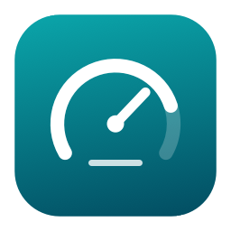
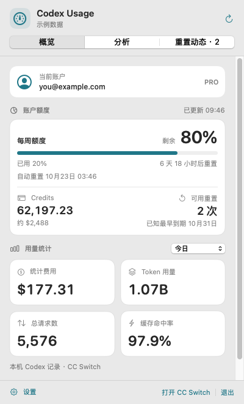
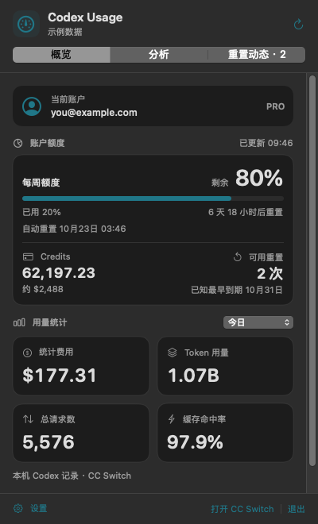
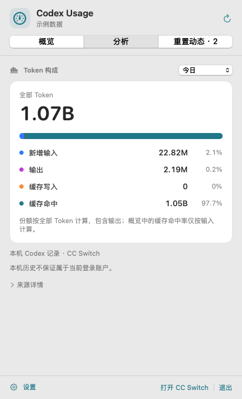
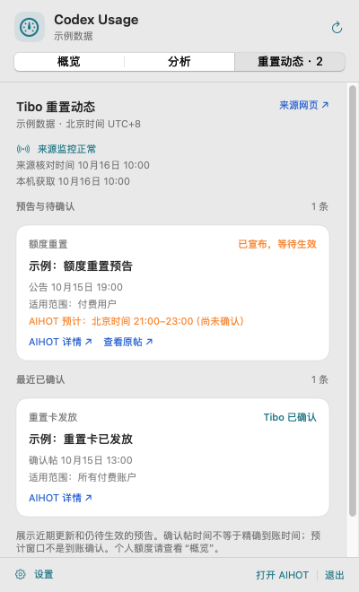
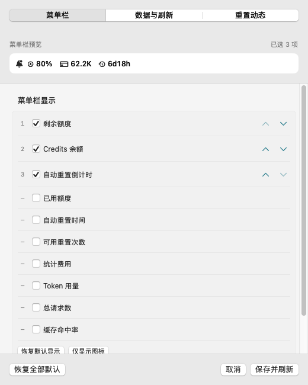

<p align="center">
  
</p>

<h1 align="center">Codex Usage</h1>

<p align="center">
  <strong>简体中文</strong> · <a href="README.en.md" lang="en">English</a>
</p>

<p align="center">Codex 的额度、用量与重置动态，放在 macOS 菜单栏。</p>

<p align="center">
  
</p>

<p align="center">
  <a href="https://github.com/brickmove/codex_usage/releases/latest">下载最新版本</a> ·
  <a href="#快速开始">快速开始</a> ·
  <a href="docs/user-guide.md">使用指南</a> ·
  <a href="https://github.com/brickmove/codex_usage/issues">反馈问题</a>
</p>

原生 SwiftUI / AppKit 菜单栏工具，复用 Codex 已有登录状态，读取 CC Switch 已存统计。图标与数值常驻菜单栏，打开面板查看账户、额度和用量详情。

<table>
  <tr><th>浅色外观</th><th>深色外观</th></tr>
  <tr>
    <td align="center"><a href="docs/images/screenshots/0.4.0/overview-light.png"></a></td>
    <td align="center"><a href="docs/images/screenshots/0.4.0/overview-dark.png"></a></td>
  </tr>
</table>

*截图来自 0.4.0 原生界面，使用示例账户、用量和动态，不代表真实账户或官方公告实录。点击图片可查看原图。*

## 功能

| 你关心的事 | Codex Usage 提供的能力 |
| --- | --- |
| 还剩多少额度 | 每周及其他额度窗口、Credits、自动重置时间与可用重置次数 |
| 菜单栏显示什么 | 自选指标、自由排序、仅显示图标；完整名称与范围放在悬停提示中 |
| 这段时间用了多少 | 已存费用、Token 用量、请求数、缓存命中率；默认当天，可改范围 |
| Token 用在哪里 | 分析新增输入、输出、缓存写入与缓存命中的数值和份额 |
| 是否有重置消息 | 独立重置动态页、来源链接、可关闭的菜单栏未读提醒 |
| 数据是否可信 | 区分过期、等待同步和真实零值；支持跨天更新与唤醒后的自动恢复 |

<table>
  <tr><th>Token 分析</th><th>重置动态</th></tr>
  <tr>
    <td align="center"><a href="docs/images/screenshots/0.4.0/analysis-light.png"></a></td>
    <td align="center"><a href="docs/images/screenshots/0.4.0/reset-news.png"></a></td>
  </tr>
</table>

<details>
<summary>查看菜单栏自定义设置</summary>

<p>勾选需要的指标，用上下箭头调整顺序，预览同步变化。设置按菜单栏、数据与刷新、重置动态分类；取消可撤销草稿，保存才生效。</p>
<p align="center"><a href="docs/images/screenshots/0.4.0/settings-menu.png"></a></p>

</details>

## 快速开始

### 运行要求

| 项目 | 要求 |
| --- | --- |
| 系统与芯片 | macOS 14+、Apple Silicon；当前安装包为 arm64 |
| Codex | 已安装并登录 Codex CLI，用于识别账户及查询额度 |
| CC Switch | 统计功能需要其本机数据库及会话同步；未提供统计来源时，额度功能仍可独立使用 |
| 网络 | 账户额度与重置动态需要联网，本地统计读取 CC Switch 数据库 |

### 安装与首次使用

1. 从 [GitHub Releases](https://github.com/brickmove/codex_usage/releases/latest) 下载 `.pkg` 安装包；使用发布包无需安装 Swift 开发工具。
2. 双击安装包，将应用安装到“应用程序”，启动 **Codex Usage**。它常驻菜单栏，首次启动会展开面板。
3. 确认 Codex CLI 已登录。需要用量统计时，打开 CC Switch 并启用其会话自动扫描；默认读取 `~/.cc-switch/cc-switch.db`。
4. 在“设置 → 菜单栏”选择显示项，在“数据与刷新”调整查询间隔、统计范围或数据路径。

**分发说明：** 当前应用使用 ad-hoc 签名，安装包尚未完成 Developer ID Installer 签名和 Apple 公证，跨机器安装可能受到 Gatekeeper 限制。暂未提供 Intel 安装包或自动更新。更新前先退出旧版，再安装新版；已有设置保留。

每个 Release 附带 SHA-256 校验文件。以 0.4.0 为例，将两个文件放在同一目录后执行：

```bash
shasum -a 256 -c Codex-Usage-0.4.0-arm64.pkg.sha256
```

## 数据来源与隐私

| 内容 | 来源 | 说明 |
| --- | --- | --- |
| 当前账户、额度、Credits、重置 | Codex App Server | 复用所选 Codex 配置的登录状态，无需在本应用重新登录 |
| 费用、Tokens、请求数、缓存命中率 | CC Switch 本地 SQLite 数据库 | 只读查询，费用直接汇总已存金额，不根据模型价格重新计算 |
| 重置动态 | [AIHOT 的 Tibo 重置监控](https://aihot.news/codex-reset) | 第三方整理，预计窗口和确认帖时间不能等同个人账户到账时间 |

本应用不直接读取认证文件、不保存 OAuth 凭据；账户显示信息仅保留在内存中。设置只保存路径、时间范围及显示偏好。发布包不包含个人数据库、登录凭据或用户设置。

本机历史统计不保证按 ChatGPT 账户拆分，不能因为面板显示当前账户，就将全部历史归到该账户。统计费用也不等于订阅实付或 Credits 扣款。字段映射、去重及归档边界见 [数据源说明](docs/data-sources.md)。

## 常见问题

**为什么用量显示 `—`？** 可能尚未同步到所选时段。面板会标明来源状态；打开 CC Switch、确认自动扫描后重新读取。`—` 与真实零用量不同，频繁刷新本工具也不会触发 CC Switch 扫描。[查看同步说明](docs/user-guide.md#统计同步与数据状态)

**启动后没有普通窗口？** 应用默认只驻留菜单栏。点击菜单栏状态项打开面板，右击可进入设置或退出；打开设置时会临时显示 Dock 图标。

**可以更改默认显示和统计范围吗？** 可以。菜单栏项目和顺序可自选；统计支持当天、最近 24 小时、7 天、30 天、全部时间和自定义时段，设置会在下次启动时恢复。

| 快捷键 | 操作 |
| --- | --- |
| `⌘R` | 刷新当前页面 |
| `⌘,` | 打开设置 |
| `Esc` | 关闭面板 / 取消设置 |
| `⌘Q` | 退出应用 |

## 文档与参与

- [使用指南](docs/user-guide.md)：显示项目、刷新设置、统计同步、账户与重置动态。
- [开发指南](docs/development.md)：源码构建、打包、诊断、测试与截图复现。
- [验证记录](docs/verification.md)：106 项测试、原生界面检查及未实测边界。
- [重置动态协议](docs/reset-news.md) · [第三方声明](THIRD_PARTY_NOTICES.md)。
- [版本与安装包](https://github.com/brickmove/codex_usage/releases)：[0.4.0 产品打磨](docs/releases/v0.4.0.md)，[0.3.3 初始基线](https://github.com/brickmove/codex_usage/releases/tag/v0.3.3)。

欢迎通过 [Issues](https://github.com/brickmove/codex_usage/issues) 反馈问题或建议。请附应用版本、macOS 版本、复现步骤和脱敏后的错误信息；不要上传认证文件、完整数据库或真实账户截图。
