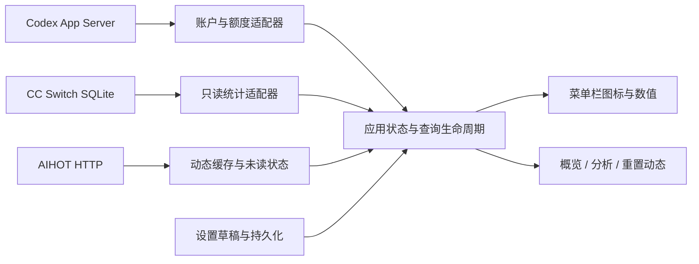

# Codex Usage 总体方案 · SPEC-1.0

方案日期：2026-10-16。功能快照对应主分支 `e28a181`，含尚未发布的图标组修复；公开下载版仍为 v0.5.0。本方案编号独立于应用版本。

这是按现有需求、代码和验证记录整理的**回溯性总体方案**，不是声称开发开始前就存在的原始输入。它可以冻结为模型重建实验的共同输入。实现可采用不同的内部结构，验收以行为和数据契约为准，不以复制现有类名、布局像素或测试数量为准。外部协议按此快照冻结，未声称重新核验了未来线上版本。

## 1. 产品目标与边界

为 macOS 用户提供常驻菜单栏的 Codex 额度、用量和重置动态工具。用户不必反复打开 CC Switch，也不必在本应用重新登录。

三个数据域独立：

| 数据域 | 来源 | 必须保持的边界 |
| --- | --- | --- |
| 当前账户、额度、Credits、自动重置及重置次数 | 已安装 Codex CLI 的 App Server | 复用已有登录状态；不是 CC Switch 本地统计 |
| 费用、Tokens、请求数、缓存命中率 | CC Switch 本地 SQLite | 只读；费用汇总已存金额，不自行计价 |
| Tibo 相关重置动态 | AIHOT 匿名只读接口 | 第三方整理；消息确认不等于个人账户到账 |

本轮不包含模型排行、小时趋势、请求明细、供应商预算、应用内登录、自动更新、Intel 安装包或 Apple 公证。候选数据可记录，不能当成已实现功能。

## 2. 平台、组成与运行方式

使用 Swift 5.9+、SwiftPM、SwiftUI、AppKit、Foundation、系统 SQLite，部署目标 macOS 14+，交付 arm64 应用。无需第三方 Swift 包。部署目标不等于已在该系统实机验证。



数据访问放在可独立测试的核心层；UI 不拼接计费规则。三个来源独立加载、报错与刷新；一个失败不能让其他来源停止工作。耗时查询不阻塞主线程。查询支持取消，迟到结果不能覆盖新范围、新账户配置或唤醒后的结果。

默认驻留菜单栏，无普通主窗口。点击状态项打开面板，右键提供设置和退出；打开设置时可以临时显示 Dock 图标。首次启动展开面板。支持 `⌘R` 刷新、`⌘,` 设置、`Esc` 关闭或取消、`⌘Q` 退出。

## 3. 功能要求

### R01 菜单栏指标

菜单栏采用图标加紧凑数值，例如 `80%`、`62.2K`、`6d18h`，不增加“今”“周”等文字前缀。悬停和辅助功能文本说明完整名称、统计范围、状态。

可选择：剩余额度、已用额度、Credits 余额、自动重置倒计时、自动重置时间、可用重置次数、统计费用、Token 用量、总请求数、缓存命中率。默认前三项为剩余额度、Credits、倒计时。支持取消全部后仅显示图标。

已选指标支持拖动手柄排序和上下箭头排序；非相邻移动保持其他项目的相对顺序。释放到有效列表之外不改序。排序按指标身份保存，取消勾选后重新启用不能错配自定义图标。预览与实际菜单栏使用同一渲染规则。

### R02 风格图标组与图片

提供经典线框、实心、圆形、极简四套完整图标组。每套中不同指标保持各自语义，额度、Credits、倒计时等不能都变成同一张图。切换组替换每个值前面的图标，不增加统一装饰前缀。圆形可使用统一外圈与不同内图形，极简使用轻量图形。

整组尺寸支持 16 / 18 / 20 pt；内置图形自动适配 macOS 菜单栏明暗。保留可折叠的单项覆盖：可为某指标选独立图形或导入图片，支持原色和模板渲染。选择或重新选择图标组时清除单项覆盖；“跟随图标组”清除该指标覆盖并继承组内配置。

导入支持 PNG、JPEG、TIFF、HEIC/HEIF、PDF、ICNS；限制 10 MB，位图最长边 4096 px。PDF 取首页，普通多帧取首帧，ICNS 取最大表示；等比缩放并保留透明留白，转存 128×128 PNG，不依赖原路径。拒绝损坏、完全透明、超限文件，导入失败保留先前配置。导入默认原色；32 / 36 / 40 px 可对应 Retina 显示尺寸。SVG 不直接支持。

未读和异常可独立增加提示图标，不替换指标图形。仅图标模式显示组内额度图标；已有旧版前置图片仅在仅图标模式保留，不能迁移成所有指标相同图形。

### R03 下拉面板与账户

面板分为“概览 / 分析 / 重置动态”。概览集中展示账户、套餐、首选额度窗口、Credits、重置次数和四项用量统计。其他额度窗口与正常来源时间可展开；异常与归档精度提示不能折叠隐藏。

账户显示来自 `account/read` 的认证类型、邮箱、套餐。邮箱可选中复制；API Key 模式如实显示认证方式，不编造邮箱。账户先独立返回，额度查询失败仍保留本次已确认的账户；未经重新确认的旧身份明确标为“上次识别账户”。退出登录和切换 Codex 配置清除旧身份，迟到响应不能恢复它。

面板高度根据状态项所在屏幕的可用区域限制，头部、页签和尾部保持可达，正文滚动；不同页签与统计范围共用一致的限高策略。

### R04 额度和可信状态

按窗口长度选择 `10080` 分钟的周窗口，否则展示实际返回的第一个窗口；不固定认为 primary 或 secondary 是周窗口。剩余百分比为 `clamp(100 - usedPercent, 0...100)`。

自动重置时间来自窗口 `resetsAt`；“可用重置次数”和次数到期明细来自另一组字段，不能混为自动重置日。次数以接口 `availableCount` 为准，不能仅按明细条目计数。

Credits 缺失显示未提供或 `—`，不能伪造为零。美元估值可复用 CC Switch 展示换算 `balance × 0.04` 后对美元取整，并标注估值；这不是官方定价承诺，也不是实际扣费。

额度快照超过 `max(刷新间隔×2, 600 秒)` 或查询失败、窗口已到重置时间时，不能继续把旧额度冒充当前值。数字、进度、已用、Credits 估值、重置详情及辅助功能描述保持同一有效性判断。单独过期的次级窗口可局部失效；有效窗口仍展示绝对重置日期。倒计时本地更新，不每秒请求接口。

### R05 统计范围和用量

默认今日：系统本地时区午夜至当前。其他范围为最近 24 小时、最近 7 天、最近 30 天、全部、自定义。7 / 30 天分别从本地今天向前 6 / 29 天的午夜开始；最近 24 小时才是滚动 86400 秒。全部从 Unix epoch 至当前。

自定义范围包含起止边界，按 Unix 秒查询；相同起止有效，开始晚于结束或早于 epoch 无效。未应用的日期草稿不改变已查询统计，错误就地解释并禁用应用或保存，不覆盖数据源错误。

显示已存费用、真实消耗 Tokens、总请求数、缓存命中率。分析页展示新增输入、输出、缓存写入、缓存命中的数值和总 Token 份额，复用同一统计快照，不另建一套聚合。零分母显示无可计算比例。

历史为本机 Codex 记录，不保证按 ChatGPT 账户拆分。顶部显示当前账户不能把本机全部历史归到该账户。费用不能倒推周额度或 Credits 扣减。

### R06 同步、跨天和唤醒

区分来源正常、来源未运行、等待同步、超过 10 分钟未更新、读取失败和真实零值。未确认同步的空统计显示 `—`；非零旧快照可保留并明确来源状态。已同步覆盖完整历史范围，不因当前来源退出或同步时间较旧而失效。读取时间与 CC Switch 数据同步时间分别显示。

本工具刷新只读取数据库，不触发会话导入。可提供打开 CC Switch 及可选后台启动设置；该设置默认关闭。不能声称后台运行必然实时同步。

本地午夜使今日、7 天、30 天范围的旧快照失效并重读，即使用户设为手动刷新；旧查询不能回填前一天数据。休眠取消旧任务；系统唤醒、屏幕恢复、会话激活合并触发恢复。网络未就绪时按 2 / 5 / 10 / 20 / 30 / 60 秒重试，网络恢复可提前重读。该恢复不依赖用户的定时刷新设置，也不等待手动点击。

### R07 重置动态

独立页展示公告、状态、适用范围、预计窗口和来源链接，全部时间使用北京时间。优先使用 `displayLabel`；范围未知时明确“原帖未说明适用人群”，不展示兼容字段中夸大的“全员重置”。`source_post` 确认与 `receipt_review` 到账核实分别标注。AIHOT 预计必须带预计/未确认语义，时间经过预计窗口不能自动视为个人到账。

首次成功读取只建立基线，包括首次为空；之后新事件、实质更正、确认、新来源帖、明确撤回可未读。同一事件合并为一个未读。单纯检查时间、updatedAt、动态估算、派生状态、普通社交互动不触发新提示；消息自然移出近期时间窗不视为撤回。快照替换时移除悬空未读。

可独立控制后台获取与菜单栏未读提醒。关闭提醒不清空未读；暂停获取停止请求并隐藏提醒。有未读提示时打开面板默认进入动态页，仅在该页实际可见时标记已读。关闭面板后保留页签选择，不能把后台新消息误标已读。

### R08 设置与主题

设置分为“菜单栏 / 外观 / 数据与刷新 / 重置动态”。单一草稿跨分类保留，实时预览；保存才生效，取消或关闭撤销。局部恢复默认只修改所属配置；全局恢复默认仍属于草稿。未知未来枚举或损坏的单个图标不能丢失其他路径、指标顺序和偏好。

默认额度每 300 秒、统计每 30 秒、动态每 600 秒；分别可设为手动。启用自动刷新时最短分别 60 / 15 / 600 秒，避免坏偏好产生高频轮询。

六套配色：青碧、海洋、森林、鸢尾、暖沙、石墨；每套支持系统、浅色、深色模式。覆盖面板与设置，不改变系统菜单栏背景。普通文本对比度至少 4.5:1；状态不能只靠颜色，控件具备可理解的辅助功能名称和值。

## 4. 冻结的数据契约

### 4.1 Codex App Server

启动配置的可执行文件及可选 CODEX_HOME，以子进程 stdio 逐行 JSON 通信，发送顺序：

1. 带 id 的 `initialize`，包含 clientInfo（name/title/version）与 `capabilities:{"experimentalApi":true}`。
2. 无 id 的 `initialized` 通知。
3. `account/read`，参数 `{"refreshToken":false}`。
4. ChatGPT 账户再调用 `account/rateLimits/read`，参数 `{}`。

每次刷新使用有超时的短生命周期会话，完成、异常、取消都关闭进程。正确跳过通知和不匹配的响应 id；未知服务端请求可回复不支持。可执行路径带空格也应工作，不将路径拼接为 shell 命令。不得发起模型生成、应用内登录或额度重置。错误信息不能反射包含凭据的任意服务端正文。

以下是离线实验的合成响应示例，数字是测试输入，非真实账户：

```jsonl
{"id":2,"result":{"account":{"type":"chatgpt","email":"demo@example.com","planType":"pro"}}}
{"id":3,"result":{"rateLimits":{"primary":{"usedPercent":20,"windowDurationMins":10080,"resetsAt":1894068000},"credits":{"hasCredits":true,"unlimited":false,"balance":"62197.23"},"planType":"pro"},"rateLimitResetCredits":{"availableCount":2,"credits":[]}}}
```

额度也可能出现在 `rateLimitsByLimitId.codex`；优先使用该 bucket，否则回退 `rateLimits`。余额兼容数值和字符串；窗口、Credits、次数均可缺失。允许 `account:null`、API Key 账户、超时、提前退出和不支持接口等独立测试。

### 4.2 CC Switch SQLite

默认 `~/.cc-switch/cc-switch.db`，允许自定义。只读打开，缺失文件不得创建空库；短读事务读取一致快照，兼容活跃 WAL，禁止对活动库使用 `immutable=1`。数据库结构不兼容时明确报错，不迁移源库。

本方案固定的统计列如下；这不是允许复制完整用户数据库的指令。

| 表 | 必需或相关字段 |
| --- | --- |
| proxy_request_logs | app_type、model、input_tokens、output_tokens、cache_creation_tokens、cache_read_tokens、total_cost_usd、status_code、created_at；可选 data_source、input_token_semantics |
| usage_daily_rollups（可不存在） | date、app_type、request_count、total_cost_usd、input_tokens、output_tokens、cache_creation_tokens、cache_read_tokens；可选 input_token_semantics |
| session_log_sync（可不存在） | file_path、last_synced_at，用所选 Codex home 的字面路径前缀筛选同步时间 |

created_at / last_synced_at 为 Unix 秒，日汇总 date 为本地 `yyyy-MM-dd`；数量为整数，total_cost_usd 为可转换为数值的已存金额。仅筛选 `app_type='codex'`。不因状态码失败就删除明细费用或请求；成功代理的特殊条件仅用于去重。

**输入 Token 归一：** I=原始输入、H=缓存命中、W=缓存写入，缺少语义列按 legacy=0 处理。

| input_token_semantics | 新增输入 F |
| --- | --- |
| fresh=2 | I |
| total=1 且 I≥H+W | I−H−W |
| legacy=0 且 I≥H | I−H |
| 其他或上述计数条件不成立 | I |

输出 O 不变。真实总量 `F+O+W+H`；缓存命中率 `H/(F+W+H)`，不是含输出分母，也不是各行命中率的平均值。四类份额以真实总量为分母。成本直接 SUM(total_cost_usd)。例如 total 输入 1000、H=700、W=100、O=200、存量费用 0.37，则 F=200、总量 1200、命中率 70%、费用仍为 0.37。

**有效记录去重：** data_source 缺失或 NULL 视为 proxy。对同 app_type、相差不超过 600 秒、输入/输出/缓存命中相同、模型忽略大小写相同或任一为 unknown 的成功 proxy（200≤status_code<300）与 session 记录，命中条件时保留 proxy、排除 session。session 来源包括 session_log、codex_session、gemini_session、opencode_session。缓存写入需相同，或 session 写入为 0 且属于 codex/gemini/opencode_session，或 proxy 写入为 0 且 legacy=0、session 属于 codex_session。查找重复代理须扩展查询范围前后各 600 秒，不能漏掉边界外的匹配代理；失败代理不抑制 session。无 data_source 列时不执行该去重。

**归档：** 明细与日汇总合并，日汇总仅纳入完整覆盖的本地日期。起点非午夜时不纳入起始日，终点未到 23:59 时不纳入结束日（遵循参考版本的分钟边界）。部分边界已有归档时显示精度提示，不能虚构分钟明细。源系统归档迁走的明细不重复叠加；不能只查明细导致长期统计缺失。

**同步状态：** lastSyncedAt≥范围结束可确认历史已覆盖；否则来源未运行提示暂停。来源在运行但无同步/记录参考，或空结果且参考时间早于范围开始，提示等待同步；其他参考超过 600 秒提示延迟。缺少同步表时可用最新 Codex 明细时间作参考，但不能伪造同步时间。

### 4.3 AIHOT HTTP 与消息

读取 `GET https://aihot.news/api/v1/codex-resets/recent`，来源页 `https://aihot.news/codex-reset`。使用声明用途的 User-Agent，支持 gzip、ETag / If-None-Match、304；429 等遵守 Retry-After。最短 600 秒，缓存、未读、最近尝试与退避状态跨进程保存。失败或 304 保留有效缓存和已读状态；无缓存的 304 不能当成空成功。

冻结响应为 schemaVersion=1、timezone=Asia/Shanghai。示例：

```json
{
  "schemaVersion": 1,
  "timezone": "Asia/Shanghai",
  "checkedAt": "2026-10-16T10:00:00+08:00",
  "historyFrom": "2026-10-09T00:00:00+08:00",
  "events": [{
    "id": "demo-reset", "type": "direct_reset", "displayLabel": "重置动态",
    "status": "announced", "title": "示例预告",
    "createdAt": "2026-10-16T09:00:00+08:00", "updatedAt": "2026-10-16T09:00:00+08:00",
    "presentation": {"scopeKnown": false, "kindExplicit": false, "status": "announced"},
    "posts": [{"id": "demo-post", "publishedAt": "2026-10-16T09:00:00+08:00", "stage": "预告", "url": "https://x.com/thsottiaux/status/1"}],
    "url": "https://aihot.news/codex-reset"
  }],
  "activities": []
}
```

事件还可包含 scope、confirmedAt、confirmationBasis、estimate/schedule（from、through、label）；presentation 可含 reportedAt、scopeLabel、audienceZh、productsZh、timeInferred。activities 的明确撤回要求 kind=event_update、statusChanged=true、action=withdraw，并包含 id、publishedAt、eventIds、url。协议未知或事件 ID 重复应报错，不崩溃。

仅打开无用户名/密码的 HTTPS 链接，精确允许 aihot.news、x.com/www.x.com、twitter.com/www.twitter.com；相似恶意域不允许。只展示摘要，不执行外部正文或网页脚本。

## 5. 安装、隐私与发布

构建产出 `Codex Usage.app`，固定安装至 `/Applications/Codex Usage.app`；安装脚本检查身份、签名、运行状态并保留偏好，安装包禁用 relocation。`.pkg` 附 SHA-256；载荷不含用户数据库、认证、偏好、缓存或截图中的真实账户信息。临时 QA 与构建副本放 `.noindex`，完成后退出并注销副本，避免重复应用入口。

不直接读取认证文件，不保存 OAuth 凭据或账户身份到磁盘；不上传用户图标。允许本地保存路径、范围、外观、图标副本及公开新闻缓存。诊断输出避免邮箱、账户 ID、凭据和任意原始响应。真实数据访问与发布必须由操作者授权；模型实验默认只使用合成数据。

README 至少有简体中文和英文两个入口，GitHub 页面可互相切换，标明下载、要求、来源、截图版本、安装限制及未发布改动。截图使用明显的示例账户和数据，不能冒充真实公告。

日常提交不创建标签或 Release。两次公开 Release 至少一个自然月，以最新 published_at 加一个月，月末夹到下月最后一天，保留 UTC 时分秒；草稿不计、预发布计入。API 错误禁止发布，上传前再检查。普通 main 推送只运行检查。已有公开标签和附件不改写，标题仅为 vX.Y.Z，功能说明放正文。开发构建可递增 build，应用发布版本在统一发版时调整。

## 6. 完成条件

必须交付可构建的原生应用、隔离示例模式、可注入的假 RPC/SQLite/HTTP、关键行为测试、构建/安装/打包脚本和使用说明。须分别报告编译结果、行为验证、真实原生 UI 验证、安装验证与未覆盖项；没有运行的检查不能写成通过。离线演示只证明模拟链路，不证明真实账户或硬件休眠可用。

关键验收场景：正常账户与三类来源；缺失额度；已识别账户但额度失败；未确认零值与真实零值；午夜跨天；唤醒网络延迟和迟到旧响应；缓存输入归一、代理去重与归档；保存/取消/重排；四套图标组逐项变化；导入图片移走原文件仍可显示；六主题明暗；新公告与推算变化去噪；304/429；月度发布边界；安装目录唯一性。

现有实现的 125 项应用测试及 9 项发布策略测试是参考证据，独立重建不要求相同测试名或条数。应验证以上契约，而非通过硬编码示例数值获得表面一致。
