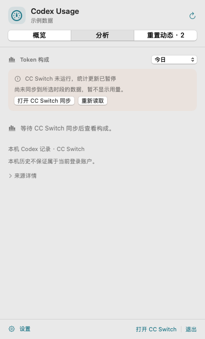

# 使用指南

[返回首页](../README.md) · [下载最新版本](https://github.com/brickmove/codex_usage/releases/latest)

## 菜单栏显示

菜单栏使用原生 SF Symbols 图标和紧凑数值，例如剩余额度 `80%`、Credits `62.2K`、倒计时 `6d17h`。悬停查看完整指标名称、统计范围及状态，点击打开面板。

在“设置 → 菜单栏”中勾选显示项，以上下箭头排序，并查看与实际菜单栏共用渲染器的预览。也可选择“仅显示图标”。默认显示剩余额度、Credits 和自动重置倒计时；已有选择和顺序会保留，下次启动恢复。

| 类别 | 可选项目 |
| --- | --- |
| 账户额度 | 剩余额度、已用额度、Credits 余额、自动重置倒计时、自动重置时间、可用重置次数 |
| 本机统计 | 统计费用、Token 用量、总请求数、缓存命中率 |

设置中的“恢复默认显示”只恢复菜单栏项目，“恢复全部默认”恢复全部设置草稿。切换分类不会丢失草稿；取消或关闭窗口不保存，点击“保存并刷新”才生效。

## 面板与账户

- **概览**：当前账户、套餐、首选额度窗口、Credits、可用重置及四项统计。其他额度窗口可展开，来源时间在“来源详情”中查看。
- **分析**：同一统计范围和快照的新增输入、输出、缓存写入、缓存命中构成。份额分母为全部 Token（包含输出）；概览缓存命中率的分母为全部输入，两者不同。
- **重置动态**：预告、确认记录、适用范围和原帖链接，统一使用北京时间。

账户来自所选 Codex 配置的已有登录状态，邮箱可选中复制。未经重新确认时标为“上次识别账户”，核对成功后标为“当前账户”；退出登录会清除旧身份，API Key 模式显示认证方式。账户额度请求失败不隐藏已识别账户，显示信息只在内存保留。

额度跟随当前登录账户，本机历史仅固定筛选 Codex 记录，不保证按账户拆分。Credits 的美元估值按 CC Switch 的展示换算方式提供，不代表实际扣款。

## 刷新与统计范围

在“设置 → 数据与刷新”中分别调整额度和本地统计的刷新间隔，也可以设为手动。

| 项目 | 默认与行为 |
| --- | --- |
| 账户额度 | 每 5 分钟在线查询 |
| 本地统计 | 每 30 秒读取 CC Switch 数据库 |
| 重置动态 | 每 10 分钟检查；在“重置动态”分类单独设置 |
| 启动与唤醒 | 自动恢复查询，网络未就绪时重试，网络恢复可提前重试 |
| 倒计时 | 在本地更新，不额外发送查询 |

统计默认当天，以系统本地时区的午夜为起点。可选最近 24 小时、最近 7 天、最近 30 天、全部时间或自定义时段。每周额度使用接口返回的周期，与统计范围独立。

自定义后点击“应用范围”。未应用的日期草稿不改变下方已查询数据；起止倒置会就地解释并禁用应用或保存，相同起止时间仍有效。当天、7 天、30 天范围跨午夜后会重新读取，即使设为手动刷新也不会继续将昨天的快照标为今天。

## 统计同步与数据状态

本工具只读取 CC Switch 已存统计，不主动导入 Codex 会话。“重新读取”不会触发 CC Switch 扫描。参考版本的 CC Switch 启动后扫描一次，后台约每 10 分钟扫描一次；打开其用量统计页时可按页面设置更频繁扫描，并须启用自动扫描。

| 显示状态 | 含义与处理 |
| --- | --- |
| 正常数值 | 已读取所选范围内的统计；已覆盖的历史时段不因来源退出而失效 |
| `—`、等待同步 | 还无法确认所选时段的零值；打开 CC Switch 并检查自动扫描 |
| 非零数值与同步提示 | 保留最近一次同步结果，当前来源可能未运行或更新延迟 |
| 此时段暂无用量记录 | 来源状态允许确认所选时段确实没有记录 |
| 额度待更新 | 快照过期、额度窗口已重置或查询失败；旧数字、图形和辅助功能不继续表示可用额度 |

“来源详情”区分会话同步时间、最近请求时间与本次读取时间。读取成功不代表来源已同步到最新请求。历史日归档只能纳入完整日期，任意分钟边界涉及归档时会显示提示。口径和源码依据见 [数据源说明](data-sources.md)。

可选开启“自动在后台启动 CC Switch”，来源未运行时由本工具在后台启动。默认关闭；本工具退出不会退出 CC Switch。需要更及时更新时，可打开 CC Switch 的用量统计页。

## 数据路径

| 设置 | 默认值 |
| --- | --- |
| CC Switch 数据库 | `~/.cc-switch/cc-switch.db` |
| Codex CLI | 自动查找 `codex`，也可指定可执行文件 |
| Codex 配置目录 | `CODEX_HOME` 或 `~/.codex`，也可指定目录 |

应用对数据库保持只读，金额直接汇总 `total_cost_usd`，不按模型价格重新计算；网络故障不影响本地统计读取。

## 重置动态与提醒

消息来自 [AIHOT 的 Tibo 重置监控](https://aihot.news/codex-reset)。这是第三方整理页面，确认帖时间不等于个人额度到账时间，预计窗口不会当作已确认。

在“设置 → 重置动态”中可分别控制获取动态、菜单栏提示和检查间隔，支持 10 分钟、30 分钟、1 小时或手动。手动检查、唤醒和重启均遵守至少 10 分钟的间隔及服务端重试时间。

首次加载建立历史基线，不把旧消息全部标为未读。之后的新公告、确认、新增来源原帖、实质更正或明确撤回会提醒；仅检查时间、推算窗口、互动数变化不反复提醒。

有未读且开启提示时，菜单栏显示带标记的铃铛；点击直接打开动态页，查看后清除提示。仅图标模式同样可用。关闭提示仍可查看动态。

缓存、已读状态、ETag 和下次允许检查时间保存在本机，重启继续使用。网络失败保留缓存并显示错误，详情见 [重置动态集成说明](reset-news.md)。

## 快捷键

`⌘R` 刷新当前页，`⌘,` 打开设置，`Esc` 关闭面板或取消设置，`⌘Q` 退出。右击状态项也可进入设置和退出。
